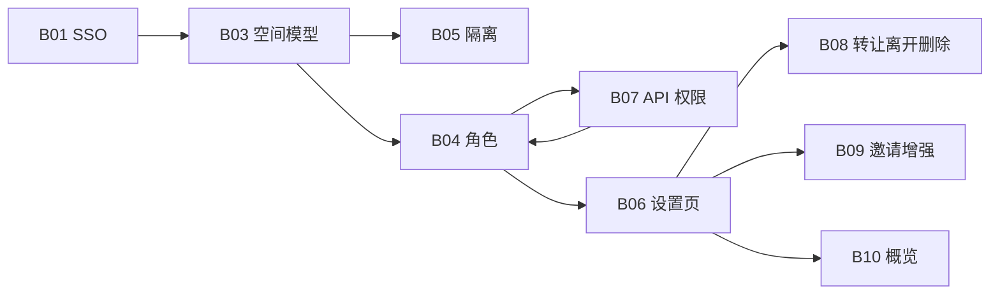

# REQ-B00 项目空间总览

| 属性 | 值 |
|------|-----|
| Epic | B 认证、团队与权限 |
| Phase | P1 |
| 状态 | 📝 设计冻结中 |
| 上级索引 | [需求清单.md](../需求清单.md) |
| 产品用语 | 界面称 **项目空间**；数据模型与 API 仍为 `teams` / `team_id` |

> **定位**：项目空间是 UIAuto 的**一级协作边界**（决策 D1）。用例、计划、环境、运行记录均归属当前空间；成员与角色决定「能看 / 能改 / 能管人」。本文是 Epic B 的**页面与能力总设计**，子需求见 B03~B10。

---

## 1. 现状与差距（2026-03）

### 1.1 已实现（可标 🟡 基础版）

| 能力 | 实现位置 | 说明 |
|------|----------|------|
| 空间模型 + `team_id` 迁移 | `teamService.js`、`schema.js` | 首次登录个人空间、存量 backfill |
| 切换当前空间 | JWT `current_team_id`、`POST /api/teams/switch` | 切换后整页刷新 |
| 创建协作空间 | `POST /api/teams` | 创建者 `owner` |
| 成员 CRUD API | `routes/teams.js` | 邀请（邮箱）、改角色、移除 |
| 改空间名称 | `PATCH /api/teams/:id` | admin+ |
| 顶栏入口 | `TeamSwitcher.jsx` | 切换 + 弹窗「团队设置」 |
| 业务按 team 过滤 | 各业务路由 | 与 B05 目标基本一致，需逐路由验收 |

### 1.2 明显不足（本次要补齐）

| 问题 | 影响 |
|------|------|
| 设置藏在顶栏小弹窗 | 无完整成员表、无角色下拉修改、无加入时间/邀请人展示 |
| **API 未按角色拦截写操作** | `viewer` 仍可能导入/删用例（B07） |
| 无转让 owner、无删空间、无「离开空间」 | 人员变动与空间生命周期无法闭环（B08） |
| 邀请只能靠**完整邮箱**且对方须先 SSO | 协作成本高（B09） |
| 无独立设置页 / 路由 | 无法从导航进入、无空间概览与统计（B06、B10） |
| 个人空间与协作空间未区分策略 | 误删协作空间、个人空间被邀请逻辑混乱（B06） |
| 操作审计未挂接 | 成员变更无法追溯（联动 REQ-A02，P2） |

---

## 2. 设计目标

| 目标 | 说明 |
|------|------|
| **可治理** | owner/admin 在统一「空间设置」中维护成员、角色、名称与危险操作 |
| **可感知** | 普通成员能查看「我在哪、我是什么角色、谁能管」 |
| **可强制** | 后端对 viewer/member/admin 的写接口与 B04 矩阵一致 |
| **可演进** | P1 邮箱邀请；P2 用户搜索、邀请链接、审计 |

---

## 3. 信息架构

```
顶栏 [当前空间名 ▾]
├── 切换到其他空间
├── 空间设置          → /settings/space  （REQ-B06，替代纯弹窗）
└── 新建项目空间

/settings/space（当前 JWT 空间，或 ?teamId= 仅当用户为该空间成员）
├── 概览（REQ-B10）     名称、slug、成员数、资源摘要、我的角色
├── 成员（REQ-B04/B06） 列表、改角色、邀请、移除
├── 基本设置（REQ-B06） 改名、slug 只读展示
└── 高级（REQ-B08）     转让所有权、离开空间、删除空间（owner，非个人空间）

业务页（用例/计划/环境）
└── 按 req.teamId + req.teamRole 控制按钮显隐与 API 403/404
```

---

## 4. 角色与权限（与 REQ-B04 一致）

| 角色 | 代码 | 一句话 |
|------|------|--------|
| 所有者 | `owner` | 空间最高权限，可转让、删空间（协作空间） |
| 管理员 | `admin` | 管成员与改名，不可删空间 |
| 成员 | `member` | 用例/计划/环境/执行 |
| 只读 | `viewer` | 仅查看用例、计划、报告 |

完整矩阵见 [REQ-B04-成员与角色.md](./REQ-B04-成员与角色.md)。**B07** 负责在后端路由层落地。

### 个人空间策略（B06）

- `slug` 匹配 `personal-{userId}` 的空间视为**个人空间**。
- 个人空间：仅 owner 一人（P1 不开放邀请）；不可删除、不可转让（仅可改名）。
- 协作空间：`slug` 非 personal 前缀；可多人、可转让、owner 可删（需二次确认 + 无进行中执行，P2 细化）。

---

## 5. 子需求拆分与推荐实现顺序

| 顺序 | ID | 名称 | 依赖 | 交付摘要 |
|:----:|----|------|------|----------|
| 1 | [B05](./REQ-B05-团队资源隔离.md) | 资源隔离验收 | B03 | 跨空间 404 清单测试 + 缺口修补 |
| 2 | [B07](./REQ-B07-API权限矩阵落地.md) | API 权限矩阵 | B04 | viewer 写操作 403；路由挂 `requireTeamRole` |
| 3 | [B06](./REQ-B06-空间设置页.md) | 空间设置页 | B04 | `/settings/space`、成员表、改角色 UI |
| 4 | [B04](./REQ-B04-成员与角色.md) | 成员与角色（闭环） | B06 | 前端与 API 验收项全部勾选 |
| 5 | [B08](./REQ-B08-所有权转让与离开空间.md) | 转让 / 离开 / 删空间 | B06 | 新 API + 危险区 UI |
| 6 | [B09](./REQ-B09-成员邀请与发现.md) | 邀请增强 | B06 | 按姓名/uid 搜索、错误提示优化 |
| 7 | [B10](./REQ-B10-空间概览与统计.md) | 空间概览 | B06 | 用例/计划/环境计数、最近活动（轻量） |
| 8 | [B03](./REQ-B03-团队空间.md) | 团队空间（文档同步） | — | 状态改为已实现项 + 链接 B00 |

**不纳入 P1**：全平台超管后台（用户全站禁用）、WPS 组织架构同步、空间级配额计费。

---

## 6. 页面线框（空间设置 · 成员 Tab）

```
┌─────────────────────────────────────────────────────────────────┐
│ 空间设置 · 文档测试组                    我的角色：管理员          │
├──────────┬──────────────────────────────────────────────────────┤
│ 概览     │  成员 (8)                          [邀请成员]          │
│ 成员  ●  │  ─────────────────────────────────────────────────  │
│ 基本设置 │  姓名      账号/邮箱        角色 ▾    加入时间   操作  │
│ 高级     │  张三      zhang@wps.cn    所有者    2026-01-01  —    │
│          │  李四      li@wps.cn       成员 ▾    2026-02-01  移除  │
│          │  …                                                   │
└──────────┴──────────────────────────────────────────────────────┘
```

---

## 7. Epic 验收（P1 完成定义）

- [ ] 任意成员可打开空间设置页，看到自己的角色；无权限的操作按钮不展示
- [ ] admin+ 可邀请、改角色、移除（含 owner 不可删约束）
- [ ] viewer 调用写 API（导入/建计划/改环境）统一 403
- [ ] owner 可转让所有权；成员可离开非个人空间
- [ ] owner 可删除协作空间（确认文案 + 资源提示）
- [ ] 顶栏仍可快速切换空间；设置页与弹窗行为一致或弹窗降级为「打开设置页」

---

## 8. 依赖关系



---

## 9. 变更记录

| 日期 | 说明 |
|------|------|
| 2026-03-14 | 初版：现状差距、IA、子需求顺序 B06~B10 |
