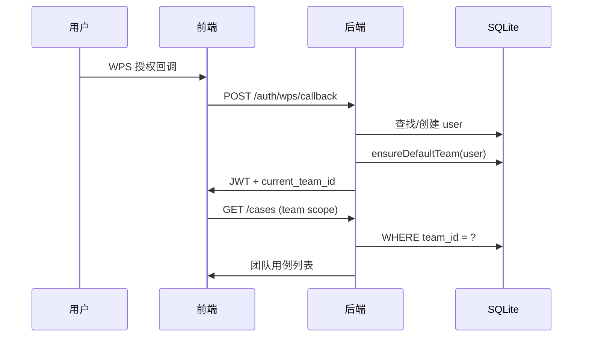

# REQ-B03 团队空间（Team）

| 属性 | 值 |
|------|-----|
| Epic | B 认证、团队与权限 |
| Phase | P1 |
| 状态 | 🟡 部分实现 |
| 上级索引 | [需求清单.md](../需求清单.md) · [REQ-B00 总览](./REQ-B00-项目空间总览.md) |

> **全局决策 D1**：用例/计划/环境归属 **团队库**（`team_id`），不再仅按 `user_id` 隔离。

---

## 1. 需求概述

**目标**：引入 **Team（团队空间）** 作为 UIAuto 中用例、计划、执行环境、运行记录的一级归属单位。同一团队成员共享资产、协作编辑；用户可加入多个团队并切换当前工作上下文。

**用户故事**

- 作为测试负责人，我希望创建「文档业务测试团队」，让 5 名同事共用用例库与测试环境。
- 作为测试同学，我登录后默认进入自己的团队，也可切换到参与的其他团队。
- 作为平台，每个 SSO 用户首次登录自动拥有「个人团队」，保证历史数据可平滑迁移。

---

## 2. 范围

### In Scope

- `teams` 表与 CRUD API
- 用户首次登录自动创建默认团队（个人空间）
- JWT / Session 携带 `current_team_id`
- 业务表增加 `team_id`（cases、plans、environments、runs）
- 顶栏团队切换器

### Out of Scope

- WPS 企业组织架构自动同步
- 跨团队用例复制 / 发布市场
- 团队级计费与配额（后续）

---

## 3. 数据模型

### 3.1 teams

```sql
CREATE TABLE teams (
  id INTEGER PRIMARY KEY AUTOINCREMENT,
  name TEXT NOT NULL,
  slug TEXT NOT NULL UNIQUE,
  avatar_url TEXT,
  created_by INTEGER NOT NULL REFERENCES users(id),
  created_at TEXT DEFAULT (datetime('now', '+8 hours')),
  updated_at TEXT DEFAULT (datetime('now', '+8 hours'))
);

CREATE INDEX idx_teams_slug ON teams(slug);
```

| 字段 | 说明 |
|------|------|
| `name` | 显示名，如「文档测试组」「张三的个人空间」 |
| `slug` | URL 友好标识，默认 `personal-{user_id}` 或用户自定义 |
| `created_by` | 创建者 user_id |

### 3.2 默认团队策略

用户 **首次 SSO 登录** 时：

```javascript
async function bootstrapUserTeams(user) {
  const team = db.prepare(`
    INSERT INTO teams (name, slug, created_by)
    VALUES (?, ?, ?)
  `).run(`${user.name || user.email}的空间`, `personal-${user.id}`, user.id);

  const teamId = team.lastInsertRowid;
  db.prepare(`
    INSERT INTO team_members (team_id, user_id, role)
    VALUES (?, ?, 'owner')
  `).run(teamId, user.id);

  return teamId;
}
```

### 3.3 业务表 team_id

| 表 | team_id | created_by | 说明 |
|----|---------|------------|------|
| `cases` | ✅ NOT NULL | ✅ | 用例归属团队 |
| `plans` | ✅ | ✅ | 计划归属团队 |
| `execution_environments` | ✅ | ✅ | 环境团队共享 |
| `case_runs` | ✅ | — | 试跑记录 |
| `runs` | ✅ | — | 计划执行 |
| `api_tokens` | ✅ | ✅ | MCP Token |

**语义**

- `team_id`：资源归属，决定可见范围
- `created_by` / `user_id`：创建人，用于展示「创建者」，不作为隔离边界

---

## 4. API 设计

### 4.1 团队 CRUD

```
GET  /api/teams
```

响应：

```json
{
  "teams": [
    { "id": 1, "name": "张三的空间", "slug": "personal-3", "role": "owner", "member_count": 1 },
    { "id": 2, "name": "文档测试组", "slug": "doc-qa", "role": "member", "member_count": 8 }
  ],
  "current_team_id": 1
}
```

```
POST /api/teams
{ "name": "文档测试组", "slug": "doc-qa" }   // slug 可选，冲突则 409
```

```
GET  /api/teams/:id
PATCH /api/teams/:id
{ "name": "新名称" }   // 需 admin+
```

### 4.2 切换当前团队

```
POST /api/teams/:id/switch
```

- 校验用户为该团队成员
- 签发新 JWT（`current_team_id` 更新）或写 session
- 响应：`{ "current_team_id": 2, "token": "..." }`

### 4.3 登录响应扩展

`GET /api/auth/me` 增加：

```json
{
  "id": 3,
  "email": "user@wps.cn",
  "name": "张三",
  "role": "user",
  "current_team_id": 1,
  "teams": [{ "id": 1, "name": "张三的空间", "role": "owner" }]
}
```

---

## 5. Service 层

```javascript
// backend/src/services/teamService.js

export function listUserTeams(userId) { ... }
export function getTeam(teamId, userId) { ... }  // 校验成员
export function createTeam(userId, { name, slug }) { ... }
export function switchTeam(userId, teamId) { ... }
export function ensureDefaultTeam(userId) { ... }
```

**中间件**

```javascript
export function requireTeam(req, res, next) {
  const teamId = req.user.current_team_id;
  if (!teamId) return res.status(400).json({ error: '请先选择团队' });
  req.teamId = teamId;
  next();
}
```

所有 `/api/cases`、`/api/plans` 等路由：`requireAuth` → `requireTeam`。

---

## 6. 前端

### 6.1 TeamSwitcher 组件

位置：顶栏 `WorkbenchLayout` 右侧，用户菜单旁。

```
[ 文档测试组 ▾ ]
  ├─ 张三的空间 (owner)
  ├─ 文档测试组 (member) ✓
  └─ + 创建团队
```

- 切换 → `POST /teams/:id/switch` → 刷新 `UserContext` → 各页 `refetch`
- `localStorage.uiauto_last_team_id` 作刷新恢复

### 6.2 创建团队

轻量弹窗：名称 + 可选 slug。

---

## 7. 安全与权限

- 非成员访问 `GET /teams/:id` → 404
- 创建团队自动将创建者设为 `owner`
- 超级管理员 `super_admin` 可跨团队运维（只读，审计）

---

## 8. 迁移与兼容

### 8.1 一次性迁移脚本

```sql
-- 1. 为每个 user 创建 personal team + owner membership
-- 2. UPDATE case_catalog SET team_id = (user's default team) WHERE team_id IS NULL
-- 3. 同理 plans, execution_environments, recorded_runs, runs
```

### 8.2 过渡期

- `case_catalog` 加 `team_id` 列，与 `cases` 迁移并行
- API 无 `team_id` 的旧客户端：默认用 JWT `current_team_id`

---

## 9. 验收标准

- [ ] 新用户 SSO 后自动有默认团队且为 owner
- [ ] 可创建第二个团队并切换
- [ ] 切换团队后用例列表仅显示该团队数据
- [ ] 新建用例 `team_id` = 当前团队
- [ ] `GET /auth/me` 返回 teams 与 current_team_id

---

## 10. 依赖关系

- **前置**：REQ-B01（SSO）
- **后续**：REQ-B04、REQ-B05、REQ-C01、REQ-G01、REQ-H01

---

## 11. 序列图：首次登录


