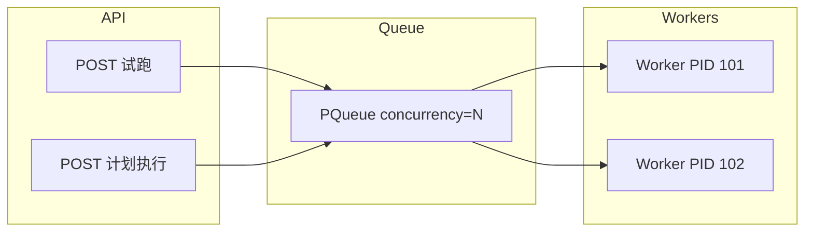

# REQ-J05 多 Worker 并发执行

| 属性 | 值 |
|------|-----|
| Epic | J 执行引擎 |
| Phase | P2 |
| 状态 | ⬜ 未开始 |
| 上级索引 | [需求清单.md](../需求清单.md) |

> **全局决策 D2**：执行队列支持 **多 Worker 并发**，通过环境变量配置。

---

## 1. 需求概述

**目标**：试跑与计划执行不再强制全局串行（当前 `PQueue({ concurrency: 1 })`），可配置同时运行 N 个 Playwright 任务，提升团队吞吐。

**约束**

- 单条计划内用例默认仍 **串行**（避免同一环境账号冲突）
- 不同试跑 / 不同计划可并行
- 需防止 Playwright 浏览器进程互相干扰（独立 `result_dir`、独立 worker 进程）

---

## 2. 配置

```bash
# backend/.env
RUN_WORKER_CONCURRENCY=2        # 全局最大并发执行数，默认 2
RUN_PLAN_CASE_CONCURRENCY=1     # 单计划内用例并发，默认 1（串行）
RUN_QUEUE_MAX_PENDING=50        # 排队上限，超出返回 429
```

| 变量 | 默认 | 说明 |
|------|------|------|
| `RUN_WORKER_CONCURRENCY` | 2 | 同时运行的 worker 子进程数 |
| `RUN_PLAN_CASE_CONCURRENCY` | 1 | 同一 plan run 内并行用例数（P2 可保持 1） |
| `RUN_QUEUE_MAX_PENDING` | 50 | 防雪崩 |

---

## 3. 队列架构



```javascript
// backend/src/services/runQueue.js
import PQueue from 'p-queue';

const concurrency = Math.max(1, Number(process.env.RUN_WORKER_CONCURRENCY || 2));
export const globalRunQueue = new PQueue({ concurrency });

export function enqueueRun(jobFn, { label, teamId, runId }) {
  const pending = globalRunQueue.pending + globalRunQueue.size;
  if (pending >= MAX_PENDING) throw new Error('执行队列已满，请稍后重试');

  return globalRunQueue.add(async () => {
    console.log(`[RunQueue] start ${label} runId=${runId} team=${teamId}`);
    await jobFn();
  });
}
```

**计划执行锁**：同一 `plan_run_id` 内用例串行 → 子队列或 mutex。

```javascript
const planLocks = new Map(); // planRunId -> PQueue(1)

function getPlanQueue(planRunId) {
  if (!planLocks.has(planRunId)) {
    planLocks.set(planRunId, new PQueue({ concurrency: PLAN_CASE_CONCURRENCY }));
  }
  return planLocks.get(planRunId);
}
```

---

## 4. Worker 进程模型

沿用现有 `recordedRunWorker.js` 模式，每次任务 spawn 独立子进程：

```
API 进程
  └─ globalRunQueue
       ├─ spawn(node, [caseRunWorker.js, runId])  // 试跑
       └─ spawn(node, [planRunWorker.js, runId])  // 计划（或统一 worker）
```

**资源隔离**

| 项 | 策略 |
|----|------|
| 结果目录 | `results/cases/{runId}/` 唯一 |
| auth.json | 每任务临时目录，不共享 |
| 端口/浏览器 | Playwright 默认隔离 |
| CPU/内存 | 并发 N 由运维按机器规格配置 |

---

## 5. 数据模型（可选监控表）

```sql
CREATE TABLE run_workers (
  id INTEGER PRIMARY KEY AUTOINCREMENT,
  team_id INTEGER,
  run_type TEXT NOT NULL,     -- case_run | plan_run
  run_id INTEGER NOT NULL,
  worker_pid INTEGER,
  status TEXT NOT NULL,       -- starting | running | finished | failed
  started_at TEXT,
  finished_at TEXT
);
```

---

## 6. API

```
GET /api/status/queue
```

```json
{
  "concurrency": 2,
  "active": 1,
  "pending": 3,
  "workers": [
    { "run_type": "case_run", "run_id": 88, "pid": 12345, "team_id": 1 }
  ]
}
```

取消：`POST /case-runs/:id/cancel` 仅 kill 对应 PID，不影响其他 worker。

---

## 7. 前端

- 可选：顶栏或系统状态显示「执行中 1/2」
- 试跑按钮在队列满时 toast「队列已满」

---

## 8. 风险与缓解

| 风险 | 缓解 |
|------|------|
| 同团队同账号并行登录冲突 | 单计划串行；同环境试跑提示 |
| 内存暴涨 | 默认 concurrency=2；生产按 8G 内存限制 |
| 热重载杀进程 | 保持 worker 子进程（已有） |

---

## 9. 验收标准

- [ ] `RUN_WORKER_CONCURRENCY=2` 时两个试跑同时进行
- [ ] 第 3 个任务排队，完成后自动开始
- [ ] 取消只影响目标任务
- [ ] `GET /status/queue` 数据准确
- [ ] 计划内用例默认串行不乱序

---

## 10. 依赖

- REQ-J01 CaseRunner（统一入队点）
- REQ-J02 试跑 Worker
- REQ-B05（队列任务带 team_id）

---

## 11. 迁移

- 将 `recordedRunner.js` 中 `PQueue({ concurrency: 1 })` 改为读取 `RUN_WORKER_CONCURRENCY`
- 默认从 1 → 2 需在发布说明中注明服务器资源要求
